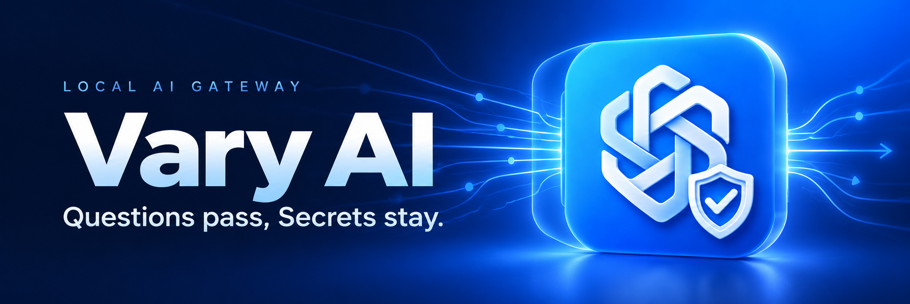
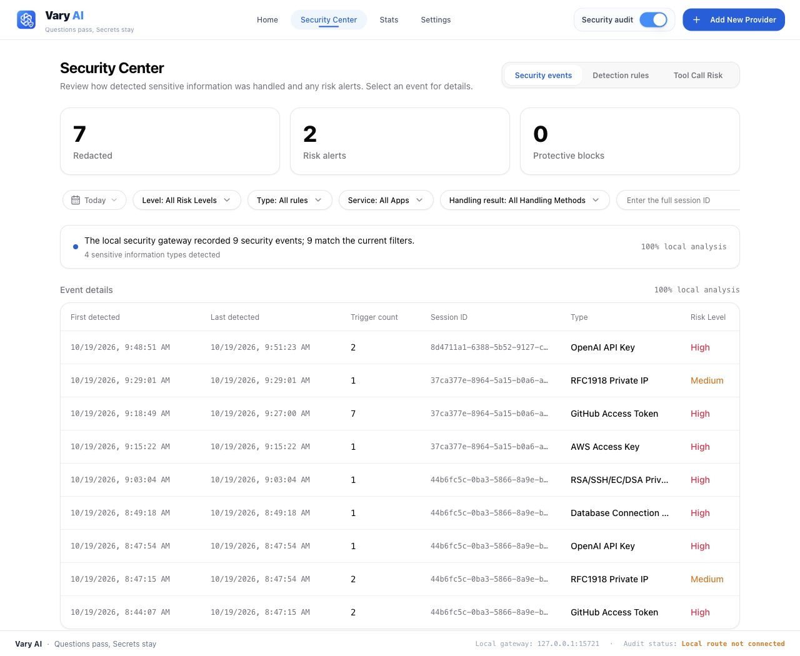
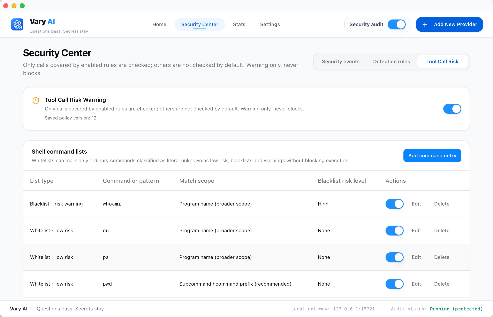
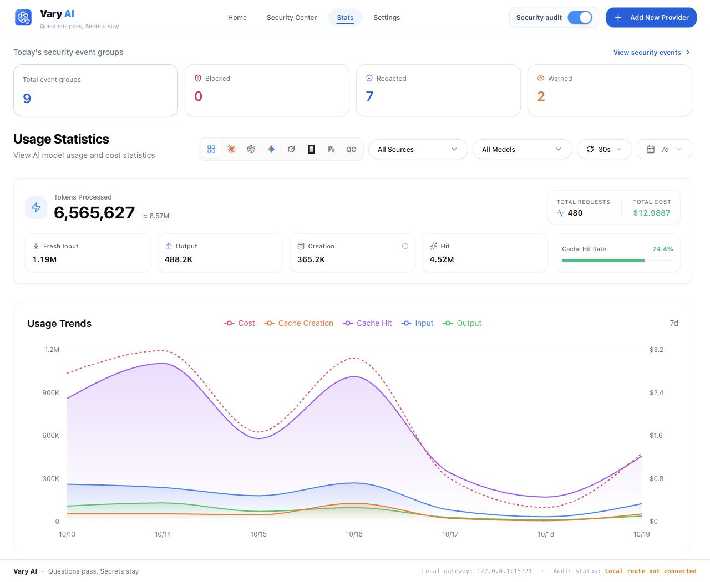
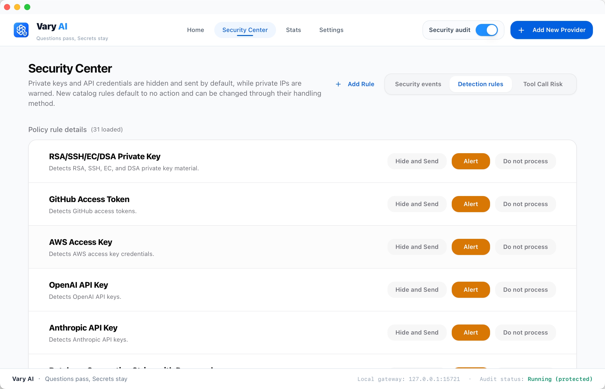

<div align="center">
  

  <h1>VaryAI</h1>

  <p><strong>The Local Control Plane & Security Gateway for All Your AI Coding Agents.</strong></p>
  <p>
    Route any model to 16+ AI agents via a 4-protocol local gateway—with built-in DLP redaction, tool risk auditing, gateway budgets, and one-click profile switching.
  </p>

  <p>
    <strong>English</strong> | <a href="README.zh-CN.md">简体中文</a>
  </p>

  <p>
    <a href="https://github.com/varium-ai/varyai/releases"></a>
    <a href="LICENSE"></a>
    
    
  </p>

  <p>
    <a href="#-quick-start">Quick Start</a> •
    <a href="#-key-features">Features</a> •
    <a href="#-supported-agents">Supported Agents</a> •
    <a href="#-local-first--privacy">Security</a> •
    <a href="#-develop-from-source">Development</a> •
    <a href="docs/README.md">Docs</a>
  </p>
</div>

---

## ⚡ Why VaryAI?

If you work with **Claude Code, Codex, Gemini CLI, OpenCode, TRAE**, or other AI coding tools, you probably run into the same friction every day:

- **Config sprawl**: Editing JSON/TOML files and pasting API keys across half a dozen tools.
- **Protocol lock-in**: Wanting to run an OpenAI, Gemini, or third-party model inside Claude Code or Codex, only to hit wire-protocol errors.
- **Data leakage & tool risk**: Worrying about `.env` secrets, private keys, or customer PII slipping into prompts—or an agent proposing a destructive shell command.

**VaryAI solves this with a single, lightweight native desktop app (Rust + Tauri) running 100% locally on your machine.**

<!-- Recommended: Add a 10–15s GIF here showing the Quick Panel (Tray) switching models & DLP in action -->

---

## ✨ Key Features

### 1. 🔀 4-Protocol Local Gateway (16-Way Translation)

Use **any provider with any agent**. VaryAI runs a local loopback gateway that transparently translates between all four major LLM protocols:

| Client \ Upstream           | Anthropic Messages | OpenAI Chat Completions | OpenAI Responses API | Gemini Native (`generateContent`) |
| :-------------------------- | :----------------: | :---------------------: | :------------------: | :-------------------------------: |
| **Anthropic Messages**      |       Native       |           ✅            |          ✅          |                ✅                 |
| **OpenAI Chat Completions** |         ✅         |         Native          |          ✅          |                ✅                 |
| **OpenAI Responses API**    |         ✅         |           ✅            |        Native        |                ✅                 |
| **Gemini Native**           |         ✅         |           ✅            |          ✅          |              Native               |

- Supports streaming SSE, images, parallel tool calls, and reasoning/thinking controls.
- **One-Click Configuration Detection**: Automatically fetches model catalogs and probes upstream protocol compatibility so you don't have to guess endpoints.

### 2. 🛡️ Local DLP & Tool Risk Guard

Protect your codebase and machine before traffic ever leaves `127.0.0.1`:

- **Outbound DLP Inspection**: Detects and redacts/audits API keys, private keys, database connection strings, passwords, phone numbers, ID cards, and custom patterns in prompts and tool results.
- **Tool Risk Observation**: Monitors agent tool calls and shell commands in real time, surfacing high-risk operations in the **Security Center**.

<div align="center">
  
  
</div>

### 3. 🧠 Smart Routing, Failover & Budgets

- **Routing Groups & 9 Strategies**: Group providers and models with automatic failover, circuit breakers, and multi-account pools.
- **Gateway Keys & Quotas**: Issue local gateway keys with strict **token budgets** and **model allowlists** per agent.
- **Usage & Cost Analytics**: Track token consumption, request logs, and estimated costs across all agents in one unified dashboard.

<div align="center">
  
  
</div>

### 4. 🎛️ Multi-Agent Hub & Native Quick Panel

- **Cross-Agent Profiles (Bundles)**: Switch your entire workspace (e.g., _Work_ vs. _Personal_, or _Deep Reasoning_ vs. _Fast & Cheap_) across multiple agents at once, with diff previews and one-click undo.
- **Unified MCP, Skills & Prompts**: Manage MCP servers, Skills, system prompts, and session histories from a single interface.
- **System Tray Quick Panel**: Switch models, inspect live routing traffic, and check security alerts directly from your menu bar / system tray without opening the main window.
- **Multi-Language UI**: Built-in support for English, 简体中文, 日本語, and 繁體中文.

---

## 🤖 Supported Agents (16+ Integrations)

| Category                  | Supported Tools                                                                                         |
| :------------------------ | :------------------------------------------------------------------------------------------------------ |
| **CLI & Terminal Agents** | Claude Code, Codex, Gemini CLI, OpenCode, OpenClaw, Grok Build, Hermes, Pi, Kimi Code, Qwen Code, ZCode |
| **Desktop & IDE Agents**  | Claude Desktop (macOS / Windows), TRAE CN, Qoder CN, WorkBuddy, DoubaoWork (Audit-only), T3Code         |

> **30-Second Zero-Friction Migration**: Already using **Claude Code, Codex, OpenCode, CC Switch, or Magpie**? Import your existing providers and keys in one click during onboarding—without overwriting your unmanaged native configs.

---

## 🚀 Quick Start

1. **Download** the latest installer for **macOS**, **Windows**, or **Linux** from [GitHub Releases](https://github.com/varium-ai/varyai/releases).
2. **Import** your existing providers and API keys automatically via the Onboarding Wizard.
3. **Toggle On** local routing for any detected agent—VaryAI applies the configuration safely and lets you disconnect and restore your original settings at any time.

For detailed walkthroughs, see the [Onboarding Guide](docs/guides/onboarding.md), [Provider Routing Guide](docs/guides/provider-routing.md), [Cross-Agent Profiles](docs/guides/profiles.md), and [Gateway Keys](docs/guides/gateway-keys.md).

---

## 🔒 Local-First & Privacy

- **Loopback-Only Gateway**: Binds strictly to `127.0.0.1`. Your prompts, source code, and API keys never pass through any VaryAI cloud server.
- **Local Storage & Optional Sync**: Configurations, usage statistics, and security events stay in local SQLite databases, with optional user-controlled WebDAV or S3 backup/sync.
- **Safe Recovery**: VaryAI preserves unmanaged native configurations and supports one-click disconnect and rollback.

For technical details on our security model, read [Security Architecture](docs/architecture/security-audit.md) and [SECURITY.md](SECURITY.md).

---

## 🗺️ Roadmap & Experimental

We are actively building and validating the next wave of local gateway capabilities:

- **Intent-Based Routing**: Automatically route turns to the right model based on task intent while preserving tool-call continuity.
- **Reversible Local DLP Tokenization**: Exploring safe local placeholder restoration for supported Codex workflows.

---

## 🛠️ Develop from Source

### Prerequisites

- **Node.js** & **pnpm**
- **Rust** toolchain (see `rust-toolchain.toml`)
- Platform-specific Tauri build dependencies (see [Development Guide](docs/development.md))

### Run & Verify

```bash
# Install dependencies
pnpm install

# Start desktop app in development mode
pnpm dev

# Run frontend & backend checks
pnpm typecheck
pnpm test:unit
cargo check --manifest-path src-tauri/Cargo.toml
cargo test --lib --manifest-path src-tauri/Cargo.toml
```

See [docs/development.md](docs/development.md) and [CONTRIBUTING.md](CONTRIBUTING.md) for platform build instructions and contribution guidelines.

---

## 📄 License

VaryAI is open-source software. See [LICENSE](LICENSE) for details.
