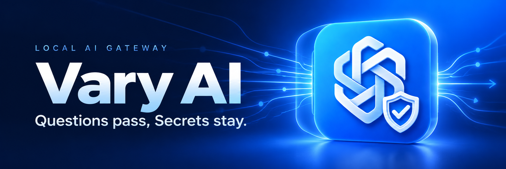
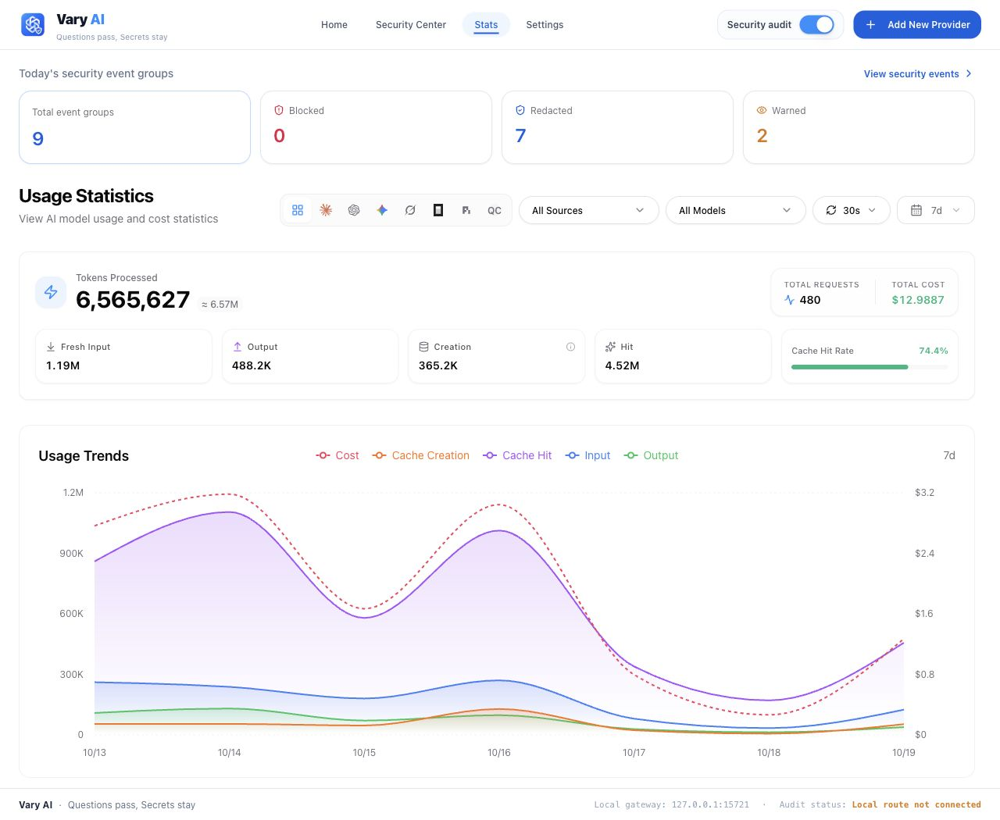
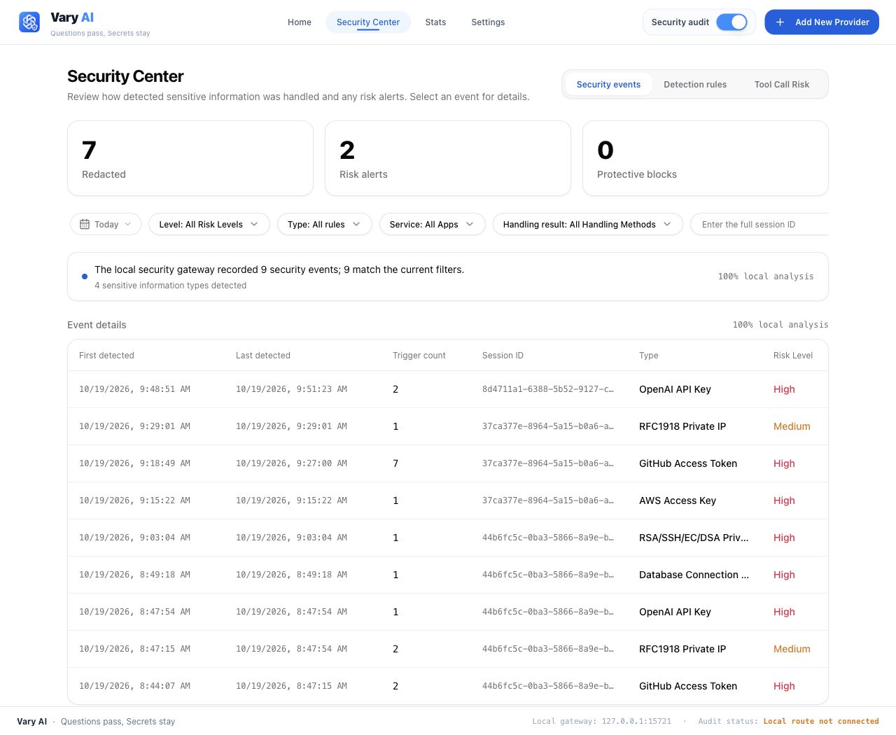
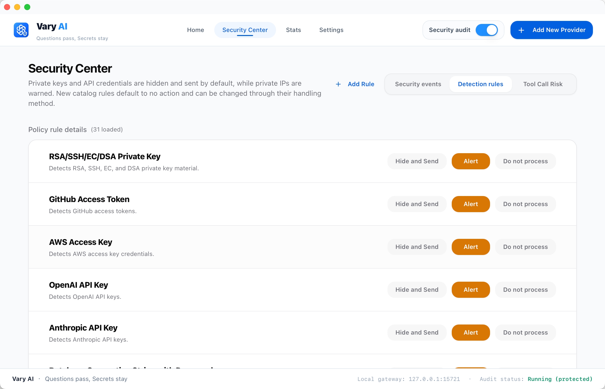
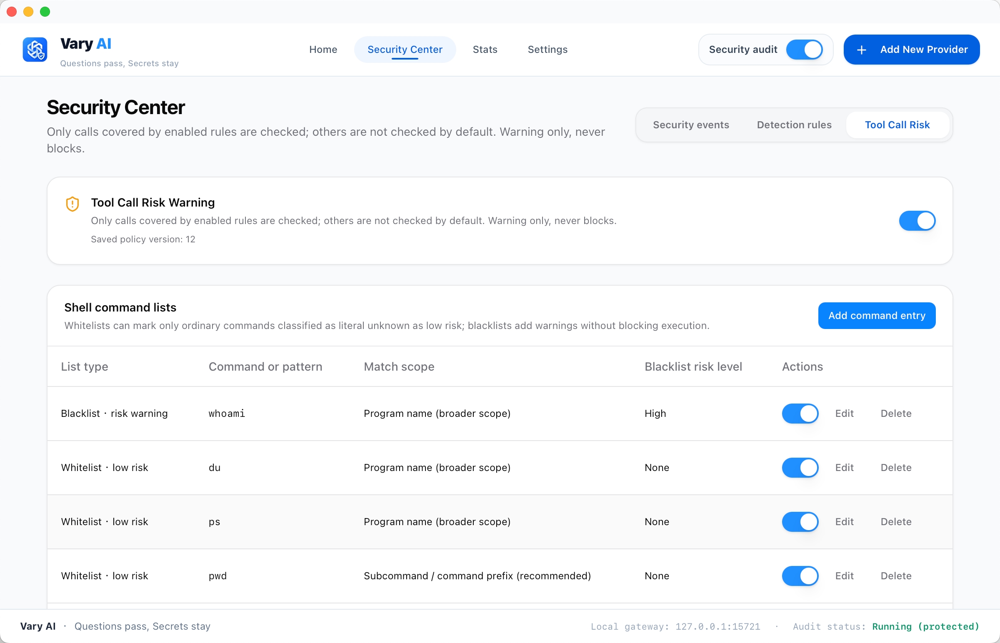

<p align="center">
  <a href="https://www.varyai.net/" title="Vary AI official website">
    
  </a>
</p>

<p align="center">
  A local AI gateway for your coding workflow.<br>
  Connect providers. Inspect outbound text. Understand model usage.
</p>

<p align="center">
  <code>Tauri + Rust</code> &nbsp; <code>React + TypeScript</code> &nbsp; <a href="LICENSE"><strong>MIT licensed</strong></a>
</p>

<p align="center">
  <a href="https://www.varyai.net/"><strong>Official Website</strong></a> &nbsp;·&nbsp;
  <a href="#quick-start"><strong>Get started</strong></a> &nbsp;·&nbsp;
  <a href="#screenshots">Screenshots</a> &nbsp;·&nbsp;
  <a href="#documentation">Documentation</a> &nbsp;·&nbsp;
  <a href="#contributing">Contribute</a> &nbsp;·&nbsp;
  <a href="#upstream-origin-and-attribution">Upstream</a> &nbsp;·&nbsp;
  <a href="#license">License</a>
</p>

Vary AI brings provider management, local routing, and request inspection into one desktop application. It is an independent derivative of [CC Switch](https://github.com/farion1231/cc-switch), with its original license and contributor attribution preserved.

## Screenshots

### Your workflow, in view

Review model usage, cache reuse, estimated costs, and security event groups in one dashboard.



<p align="center"><sub>Sample data and example policy settings are shown throughout.</sub></p>

<details>
<summary><strong>Explore the Security Center</strong> — events, detection rules, and tool-risk settings</summary>

### Review security events

Inspect grouped detections, repeat occurrences, session identifiers, and handling results.



### Configure detection rules

Choose how supported sensitive-information rules handle matches.



### Observe tool-call risk

Configure tool-risk warnings and command lists for supported tool calls.



</details>

## Built around your coding workflow

<table>
  <tr>
    <td width="33%" valign="top">
      <strong>Connect your tools</strong>
      <p>Manage provider endpoints, model routes, MCP resources, Skills, and prompts from one desktop app.</p>
    </td>
    <td width="33%" valign="top">
      <strong>Inspect before forwarding</strong>
      <p>Apply configured redaction and audit rules to supported outbound text. Review detections in the Security Center.</p>
    </td>
    <td width="33%" valign="top">
      <strong>Understand your usage</strong>
      <p>See token categories, cache reuse, estimated costs, and provider and model breakdowns.</p>
    </td>
  </tr>
</table>

Local proxy routing supports Claude Code, Codex, Gemini CLI, Grok Build, and Pi. Client bridges provide additional integration-specific capabilities. See the [routing guide](docs/guides/provider-routing.md), [configuration profiles](docs/guides/profiles.md), and [Doubao Work guide](docs/guides/doubao-work.md) for scope and setup.

Inspection covers traffic and fields handled by the enabled integration. Tool-risk observations provide warnings and records; they do not authorize, pause, or sandbox tool execution.

<details>
<summary>Explore all capabilities</summary>

| Feature                   | Description                                                                                                                                                          |
| ------------------------- | -------------------------------------------------------------------------------------------------------------------------------------------------------------------- |
| Provider management       | Manage endpoints, credentials, and model settings for supported coding tools.                                                                                        |
| Local gateway             | Route supported clients through a local HTTP proxy with streaming, protocol adaptation, retries, and configured failover. The default listener is `127.0.0.1:15721`. |
| Protocol adaptation       | Adapters for Anthropic Messages, OpenAI Chat Completions, OpenAI Responses, and Gemini. Available routes and conversion behavior depend on the client and provider.  |
| Protocol matrix           | [Four-protocol routing and verification](docs/design/protocol-bridge.md) |
| Sensitive-data inspection | Inspect supported outbound text fields with built-in and custom rules. Configure redaction, audit logging, or forwarding without inspection for each rule.           |
| Security center           | Review detected events by time, session, information type, risk level, and handling result.                                                                          |
| Tool-risk observations    | Record and flag supported tool calls covered by enabled risk rules.                                                                                                  |
| Usage statistics          | Review requests, token categories, cache reuse, estimated costs, and provider and model breakdowns.                                                                  |
| Client resources          | Manage MCP configuration, Skills, and prompts for clients that support those integrations.                                                                           |

</details>

## Quick start

### Prerequisites

- **Node.js:** the version in [`.node-version`](.node-version).
- **pnpm:** the version in [`package.json`](package.json), managed through its `packageManager` field.
- **Rust:** the stable toolchain in [`rust-toolchain.toml`](rust-toolchain.toml), including `rustfmt` and `clippy`. The crate declares Rust `1.85.0` as its minimum version.
- **Native dependencies:** Xcode Command Line Tools on macOS; MSVC C++ build tools and WebView2 on Windows; GTK and WebKitGTK development packages on Linux. See the [platform build guides](docs/guides/release-distribution.md#development-builds).

### Run from source

Clone the repository and install its dependencies:

```bash
git clone https://github.com/varium-ai/varyai.git
cd varyai
pnpm install --frozen-lockfile
pnpm dev
```

`pnpm dev` starts the Vite renderer and the native Tauri application. Exit an existing Vary AI instance before starting a separate development instance; the single-instance handler can bring an existing window to the foreground.

For frontend work, use `pnpm dev:renderer`. It serves the renderer at `http://localhost:3000`; native commands and the Rust gateway require the desktop runtime.

### Configure a client

1. Install the coding client separately, then select it in Vary AI.
2. Add a provider with your endpoint, credentials, and model settings.
3. Select the provider. Enable local routing for a supported client when you need protocol adaptation or request inspection.
4. Restart or reload the client so it reads its updated configuration, then make a small test request.
5. Review usage and security events, and configure the rules appropriate to your workflow.

Client routing changes the client's active endpoint configuration. Back up existing settings before first use. Requests are forwarded to the provider you configure; see [Local routing](docs/guides/provider-routing.md) for client-specific behavior.

## Development

See [CONTRIBUTING.md](CONTRIBUTING.md) for the development workflow and validation requirements.

<details>
<summary>Checks and local builds</summary>

Run the contributor checks from the repository root:

```bash
pnpm typecheck
pnpm build:renderer
pnpm test:unit
cargo check --manifest-path src-tauri/Cargo.toml
cargo test --lib --manifest-path src-tauri/Cargo.toml
```

The [contributing guide](CONTRIBUTING.md) describes formatting, Clippy, and integration-test requirements.

To compile the desktop application without generating installer bundles or updater artifacts:

```bash
pnpm tauri build --no-bundle --config src-tauri/tauri.no-updater.conf.json
```

See the [macOS](docs/guides/local-macos-build.md), [Windows](docs/guides/local-windows-build.md), and [Linux](docs/guides/local-linux-build.md) guides for local packaging. The no-updater build configuration controls artifact generation; it does not disable runtime update checks.

</details>

## Data and network behavior

Vary AI stores local configuration under `~/.cc-switch/` for compatibility with CC Switch. Shared configuration uses `cc-switch.db`; Vary AI audit and tool-risk records use `vary-ai.db`. Installations using the same directory can share data. See the [storage documentation](docs/architecture/storage.md) before migrating or modifying these files.

Installation statistics are optional and off by default. Builds without a configured statistics destination do not send reports. Settings provides a separate local consent control; turning it off removes the reporting ID and stops pending reports and retries. The desktop renderer does not load Google Analytics. Startup update checks and requests to your selected providers are separate network behaviors. See [Data and network behavior](docs/data-and-network.md) for details.

## Documentation

| Topic                     | Guide                                                                     |
| ------------------------- | ------------------------------------------------------------------------- |
| Usage                     | [User guide](docs/usage.md)                                               |
| Providers and routing     | [Provider setup and protocol conversion](docs/guides/provider-routing.md) |
| Sensitive-data inspection | [DLP architecture](docs/architecture/security-audit.md)                   |
| Tool-risk observations    | [Coverage and behavior](docs/architecture/tool-risk.md)                   |
| Local storage             | [Shared and extension databases](docs/architecture/storage.md)            |
| Troubleshooting           | [Troubleshooting guide](docs/troubleshooting.md)                          |
| Contributions             | [Contributing](CONTRIBUTING.md) · [Code of Conduct](CODE_OF_CONDUCT.md)   |
| Vulnerability reporting   | [Security policy](SECURITY.md)                                            |

See the [documentation index](docs/README.md) for additional integration, architecture, and build references.

## Contributing

Bug reports, focused pull requests, documentation improvements, and translations are welcome. Include reproduction steps and relevant validation, and update documentation when behavior changes. Follow [CONTRIBUTING.md](CONTRIBUTING.md) and the [Code of Conduct](CODE_OF_CONDUCT.md).

Use this project's issue tracker for Vary AI-specific reports. Follow [SECURITY.md](SECURITY.md) for sensitive reports; do not include credentials, private configuration, or customer data in public examples.

## Upstream origin and attribution

Vary AI is an independent derivative of [CC Switch](https://github.com/farion1231/cc-switch), created by Jason Young and its contributors. CC Switch provides the foundation for provider configuration, client integrations, and other inherited functionality. Vary AI adapts and extends this foundation for local routing, sensitive-data inspection, security event review, and tool-risk observations.

The retained CC Switch baseline is **[`bd247a4adb92adfee0f065f0bdaac9580cfc276a`](https://github.com/farion1231/cc-switch/commit/bd247a4adb92adfee0f065f0bdaac9580cfc276a)** — `fix(proxy): omit missing tool descriptions instead of serializing null (#7319)`.

This commit and its 2,438 ancestors remain unchanged, preserving 2,439 original CC Switch commits. Vary AI development was consolidated into a source snapshot after this baseline, with upstream notices and contributor credit retained.

Later CC Switch changes were also adapted; this baseline is the retained history boundary, not a claim that all reused code comes from that revision. See [Upstream provenance](docs/upstream-provenance.md#subsequent-upstream-contributions) for seven verified examples with original commit links and file-level evidence, and [Contributors](CONTRIBUTORS.md) for contributor credit. The examples are not an exhaustive inventory of upstream reuse.

Vary AI-specific changes and support are maintained in this repository. Please direct Vary AI reports here rather than to CC Switch maintainers. Vary AI is not an official CC Switch release.

## License

Vary AI is distributed under the **[MIT License](LICENSE)**. It permits use, modification, distribution, sublicensing, and commercial use, subject to retaining the copyright and permission notices in copies or substantial portions of the software. The software is provided without warranty; see [LICENSE](LICENSE) for the complete terms.

The original CC Switch copyright notice is preserved:

```text
Copyright (c) 2025 Jason Young
```

CC Switch's [license at the recorded baseline](https://github.com/farion1231/cc-switch/blob/bd247a4adb92adfee0f065f0bdaac9580cfc276a/LICENSE) is MIT. Retaining that notice credits the upstream work; it does not attribute all Vary AI changes to the upstream author. Dependencies and other third-party materials retain their respective licenses and notices.
