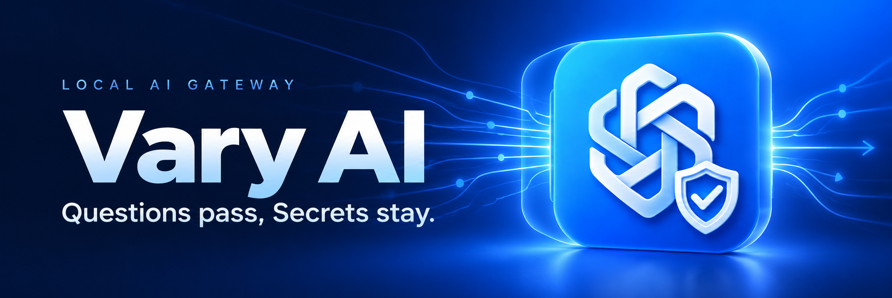
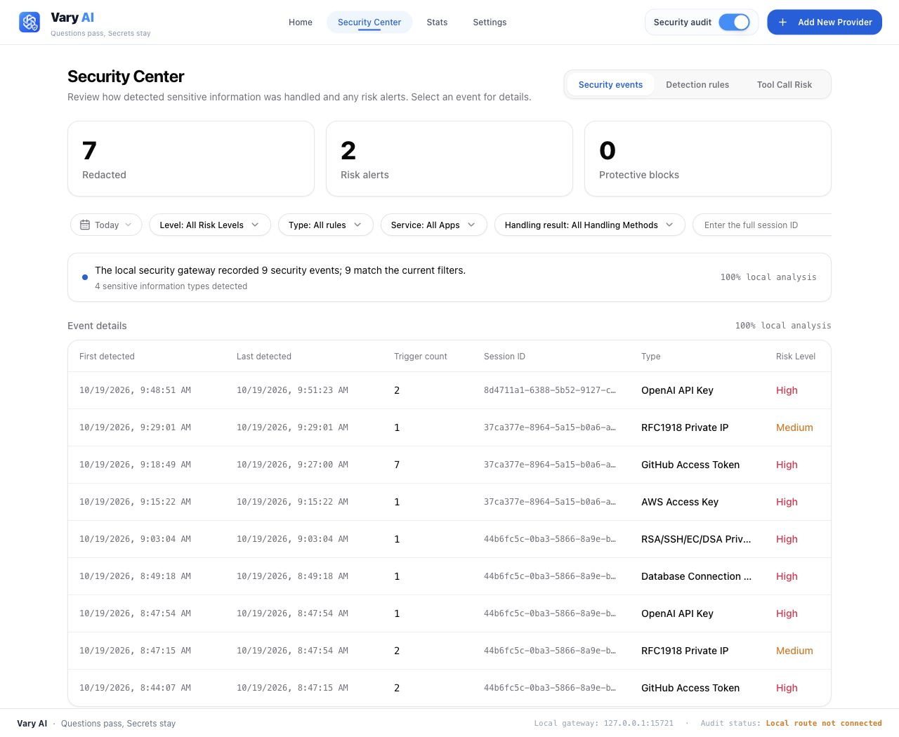
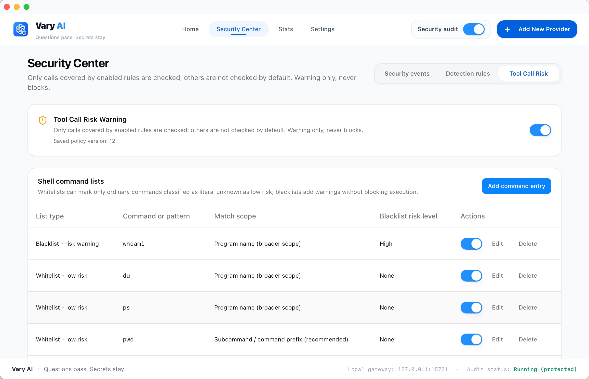
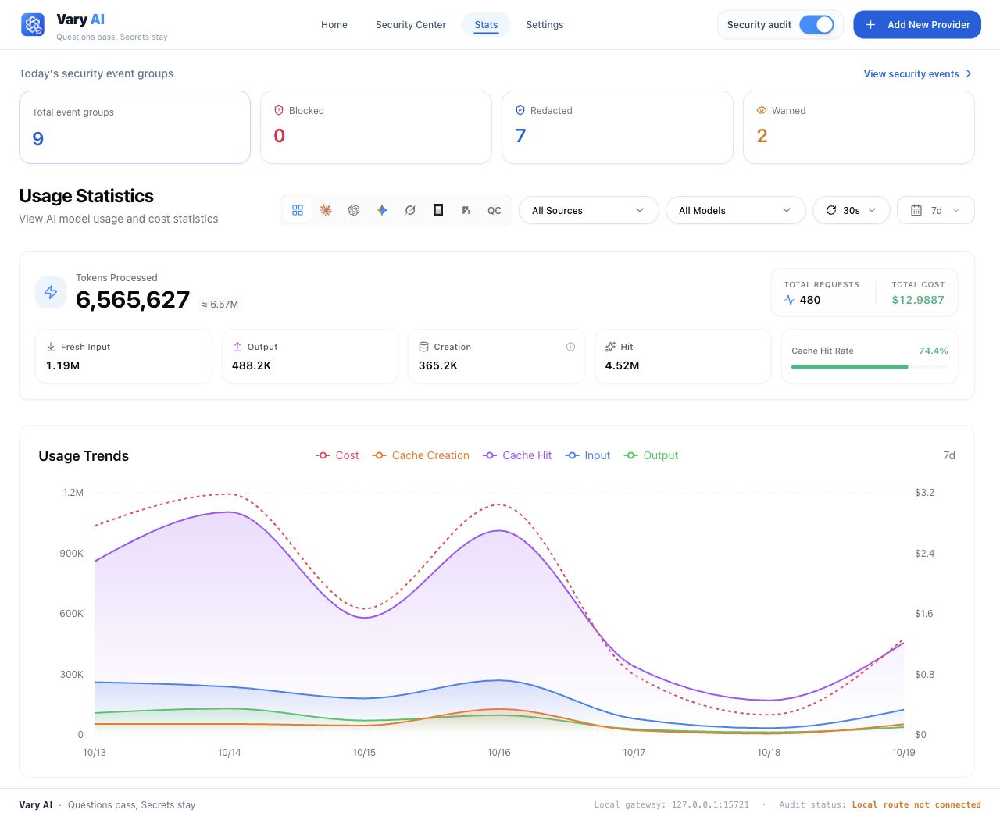
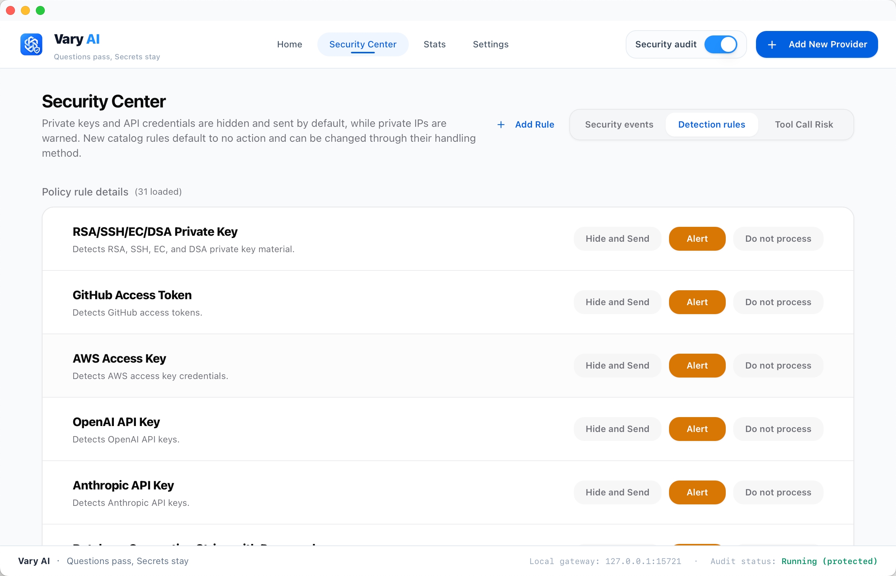

<div align="center">
  

  <h1>VaryAI</h1>

  <p><strong>管理你所有 AI 编程助手的本地控制平面与安全网关</strong></p>
  <p>
    通过四协议本地网关，将任意模型路由至 16+ 款主流 AI Agent——内置本地防泄露（DLP）脱敏、工具风险审计、网关预算控制与跨工具一键场景切换。
  </p>

  <p>
    <a href="README.md">English</a> | <strong>简体中文</strong>
  </p>

  <p>
    <a href="https://github.com/varium-ai/varyai/releases"></a>
    <a href="LICENSE"></a>
    
    
  </p>

  <p>
    <a href="#-30-秒快速上手">快速上手</a> •
    <a href="#-核心特性">核心特性</a> •
    <a href="#-支持的-ai-工具16-集成">支持工具</a> •
    <a href="#-本地优先与隐私承诺">安全架构</a> •
    <a href="#-从源码构建">开发构建</a> •
    <a href="docs/README.md">完整文档</a>
  </p>
</div>

---

## ⚡ 为什么选择 VaryAI？

如果你同时在使用 **Claude Code、Codex、Gemini CLI、OpenCode、TRAE** 等 AI 编程工具，大概率每天都在经历这些痛点：

- **配置高度分裂**：不得不在五六个工具的 JSON / TOML 文件里反复复制粘贴 API Key 和 Base URL。
- **协议互不兼容**：想在 Claude Code 或 Codex 里调用 OpenAI、Gemini 或其他第三方模型，却频繁遭遇接口协议报错。
- **数据泄露与高危命令焦虑**：担心 `.env` 密钥、私钥或客户敏感信息被误发给云端模型，或 Agent 突然提议执行破坏性 Shell 命令。

**VaryAI 用一款轻量级原生桌面应用（Rust + Tauri）彻底解决这些问题——100% 本地运行，流量不出本机。**

<!-- 建议在此插入 10–15 秒 GIF：展示从系统托盘快捷面板一键切换模型与触发 DLP 安全拦截的效果 -->

---

## ✨ 核心特性

### 1. 🔀 四协议本地网关（16 向全互通）

让**任意供应商的模型都能跑在任意 Agent 上**。VaryAI 在本机回环地址启动本地网关，透明完成四大主流大模型协议的双向互转：

| 客户端协议 \ 上游供应商协议 | Anthropic Messages | OpenAI Chat Completions | OpenAI Responses API | Gemini Native (`generateContent`) |
| :-------------------------- | :----------------: | :---------------------: | :------------------: | :-------------------------------: |
| **Anthropic Messages**      |      原生直连      |           ✅            |          ✅          |                ✅                 |
| **OpenAI Chat Completions** |         ✅         |        原生直连         |          ✅          |                ✅                 |
| **OpenAI Responses API**    |         ✅         |           ✅            |       原生直连       |                ✅                 |
| **Gemini Native**           |         ✅         |           ✅            |          ✅          |             原生直连              |

- 完整支持流式 SSE、图片输入、并行工具调用（Parallel Tool Calls）与推理深度（Reasoning / Thinking）控制。
- **一键配置探测**：自动拉取上游模型目录并探测真实协议兼容性，告别盲猜接口地址。

### 2. 🛡️ 本地防泄露（DLP）与工具风险审计

在请求离开 `127.0.0.1` 之前，为你的代码库与本机环境加上一道安全防线：

- **出站 DLP 敏感信息拦截与脱敏**：自动检测并脱敏或审计提示词及工具结果中的 API Key、私钥、数据库连接串、密码、手机号、身份证号及自定义正则规则。
- **工具风险实时观测**：持续监控 Agent 发起的工具调用与 Shell 命令，在 **安全中心（Security Center）** 中高亮标记高危操作。

<div align="center">
  
  
</div>

### 3. 🧠 智能路由、故障转移与预算控制

- **路由组与 9 种调度策略**：自由编排供应商与模型成员，支持自动故障转移（Failover）、熔断保护与多账号池调度。
- **本地网关密钥与配额**：按 Agent 签发本地网关 Key，强制执行 **Token 用量预算** 与 **模型白名单**。
- **统一用量与成本面板**：在一个仪表盘中汇总查看所有 Agent 的 Token 消耗、请求日志与估算费用。

<div align="center">
  
  
</div>

### 4. 🎛️ 多 Agent 统一管理与原生快捷面板

- **跨工具场景配置（Profile Bundles）**：一键在多个 Agent 间整体切换工作流（如“工作环境 / 个人环境”或“深度推理 / 省钱模式”），支持变更预览与一键撤回。
- **统一管理 MCP、Skills 与 Prompts**：在一个界面内集中维护 MCP 服务、Skills、系统提示词以及历史会话记录。
- **原生托盘快捷面板（Quick Panel）**：无需打开主窗口，直接从菜单栏 / 系统托盘快速切模型、看实时路由状态和最新安全告警。
- **多语言界面**：内置简体中文、English、日本語与繁體中文。

---

## 🤖 支持的 AI 工具（16+ 集成）

| 类别                   | 已支持客户端                                                                                            |
| :--------------------- | :------------------------------------------------------------------------------------------------------ |
| **CLI 与终端 Agent**   | Claude Code, Codex, Gemini CLI, OpenCode, OpenClaw, Grok Build, Hermes, Pi, Kimi Code, Qwen Code, ZCode |
| **桌面端与 IDE Agent** | Claude Desktop (macOS / Windows), TRAE CN, Qoder CN, WorkBuddy, DoubaoWork（仅审计）, T3Code            |

> **30 秒零门槛迁移**：如果你已经在用 **Claude Code、Codex、OpenCode、CC Switch 或 Magpie**，首次启动引导支持一键导入现有供应商与密钥，绝不覆盖未托管的原生配置。

---

## 🚀 30 秒快速上手

1. **下载安装**：前往 [GitHub Releases](https://github.com/varium-ai/varyai/releases) 下载对应 **macOS、Windows 或 Linux** 的安装包。
2. **一键导入**：通过首次启动向导自动导入现有的供应商配置与 API Key。
3. **开启路由**：为已检测到的 Agent 打开本地路由开关——VaryAI 会安全写入配置，并支持随时一键断开并还原原始设置。

更多使用说明请查阅：[新手引导](docs/guides/onboarding.md)、[供应商路由指南](docs/guides/provider-routing.md)、[跨 Agent 配置方案](docs/guides/profiles.md) 与 [网关密钥管理](docs/guides/gateway-keys.md)。

---

## 🔒 本地优先与隐私承诺

- **严格回环监听**：本地网关仅绑定 `127.0.0.1`，你的提示词、源代码与 API Key 永远不会经过任何 VaryAI 云端服务器。
- **本地存储与自主同步**：所有配置、用量统计与安全事件均保存在本地 SQLite 数据库中，可选开启由你自己掌控的 WebDAV 或 S3 备份同步。
- **安全可恢复**：保留客户端原有未托管配置，支持一键断开与配置回滚。

了解安全模型的技术细节，请参阅 [安全架构文档](docs/architecture/security-audit.md) 与 [SECURITY.md](SECURITY.md)。

---

## 🗺️ 路线图与实验性功能

我们正在持续开发并严格验证下一阶段本地网关能力：

- **意图路由（Intent-Based Routing）**：根据对话任务意图自动将新轮次分发至最合适的模型，同时严格保持工具调用的上下文连续性。
- **本地可逆 DLP 脱敏（Reversible Tokenization）**：在受支持的 Codex 工作流中探索安全可控的本地占位符还原机制。

---

## 🛠️ 从源码构建

### 环境要求

- **Node.js** 与 **pnpm**
- **Rust** 工具链（版本要求见 `rust-toolchain.toml`）
- 对应平台的 Tauri 构建依赖（详见 [开发指南](docs/development.md)）

### 运行与验证

```bash
# 安装前端依赖
pnpm install

# 启动桌面端开发模式
pnpm dev

# 运行前后端检查与单元测试
pnpm typecheck
pnpm test:unit
cargo check --manifest-path src-tauri/Cargo.toml
cargo test --lib --manifest-path src-tauri/Cargo.toml
```

各平台本地打包指引与贡献规范请参阅 [docs/development.md](docs/development.md) 与 [CONTRIBUTING.md](CONTRIBUTING.md)。

---

## 📄 开源协议

VaryAI 为开源软件，详见 [LICENSE](LICENSE)。
