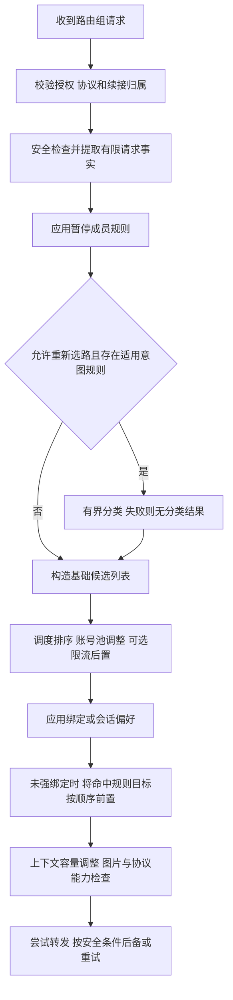

# 新建路由组配置研究与四种模板方案

日期：2026 年 11 月 13 日。分析基线：`7aaf7b189f33ae1602ebf88e5fcd73fa66eb6144`。

本文说明新建路由组及高级设置的实际行为，并给出以下四种**配置模板**：难题给强模型、简单任务给便宜模型；能力强的优先使用；速度快的优先使用；即将到期的额度优先使用。

结论：前三种可以复用当前执行机制，补充模板生成及配置确认界面；第四种缺少真实额度失效数据和对应排序能力，无法只靠现有配置准确实现。四种模板是创建配置的入口，不新增四种产品路由策略，不恢复已经撤回的 `policy` 方案。

本文中的“现状”来自当前源码，“方案”表示待实现的设计。所有供应商、模型和金额示例均为合成数据。本文按本次明确要求使用中文。

## 1 概念和执行关系

### 1.1 路由组 模板 调度与规则

| 概念               | 负责什么                                                                           | 不负责什么                       |
| ------------------ | ---------------------------------------------------------------------------------- | -------------------------------- |
| 路由组             | 保存可使用的供应商和精确模型、默认成员、后备成员及执行设置，对外提供一个模型入口   | 不保证所有成员具有相同能力       |
| 模板               | 创建时一次性填充成员、顺序、规则、分类器和高级设置，用户检查后保存                 | 本身不是每个请求都执行的算法     |
| 底层调度 `routing` | 给当前候选成员排序，例如按顺序或按近期速度                                         | `smart` 不分析任务难度           |
| 确定性规则         | 在本地判断图片、Token、推理档位、Agent、目录、时段等条件，提升目标优先级或暂停成员 | 不理解自然语言任务的难易         |
| 意图规则与分类器   | 让明确配置的模型从任务描述中选择一个规则 ID，再优先使用该规则的成员                | 不执行任务，不是可验证的能力评分 |

当前模板工厂只生成三个模板：难题与简单任务分流、便宜优先、不中断。三者均使用 `routing: "ordered"`。选择模板会打开草稿，保存才创建路由组，取消不创建。[模板工厂](../../src/lib/routingGroupTransfer.ts)、[创建界面](../../src/components/routing/IntentRoutingPanel.tsx)

此前的[路由策略简化草案](routing-strategy-simplification.md)已明确撤回四种新策略。本方案保留“模板生成普通配置”的模型，不沿用该草案的产品策略结构。

### 1.2 一次真实请求如何选模型



这是源码执行顺序的概括，不是“策略决定一切”的优先级表。特别注意：

- **强绑定高于重新选模。** 携带已观察响应状态、工具归属或其他不可迁移状态的续接，必须留在原目标；不能为了速度、价格或额度到期换账号。
- **普通会话偏好可以被规则覆盖。** `session` 是软偏好；源码先把偏好目标前置，再把命中规则目标前置。`strict` 在适用续接上保留强绑定。
- **规则目标不一定最终被使用。** 被关闭、被暂停、图片明确不支持、上下文不足、协议无法安全转换或实际不可用，都可能使其被跳过、后移或返回错误。
- **后备受到重试安全约束。** 已发送内容、工具状态、不明确的失败等情况可能禁止跨目标重放。不能把“有后备”理解为任何失败都能无缝切换。

执行依据：[真实请求处理](../../src-tauri/src/proxy/intent/mod.rs)、[静态计划](../../src-tauri/src/services/intent_routing/mod.rs)、[调度排序](../../src-tauri/src/proxy/intent/scheduling.rs)。

## 2 新建路由组的每项配置

### 2.1 基本字段与成员

| 界面或字段                   | 实际作用                                               | 使用建议                                                   |
| ---------------------------- | ------------------------------------------------------ | ---------------------------------------------------------- |
| 路由组名称 `name`            | 展示名称，最多 80 个字符；组的身份由 `id` 决定         | 用任务目标命名，例如“日常开发分流”                         |
| 模型成员 `members`           | 允许路由到的供应商与精确模型；成员可以附带固定推理档位 | 只选愿意实际调用的目标；目录可见不等于已验证推理权限       |
| 默认成员 `defaultMemberId`   | 基础候选起点；没有规则结果时首先进入基础计划           | 动态调度可以把其他成员排到它之前                           |
| 后备成员 `fallbackMemberIds` | 保存后备顺序；界面按勾选顺序生成，取消后重新勾选可调整 | 预览并确认实际顺序，不能只看成员列表的位置                 |
| 成员开关 `off`               | 从可选目标中排除该成员，保留配置                       | 适合暂时停用；不同于条件式暂停                             |
| 成员固定档位 `effort`        | 对这个成员的请求使用固定推理档位，并适配已知能力       | “跟随 Agent”保留请求意图；固定档位优先于规则的 `useEffort` |
| 成员权重 `weight`            | 仅加权调度使用，整数 1～1000，缺省为 1                 | 不是能力分数，不能用来表示“能力强优先”                     |
| 免费标记 `free`              | 覆盖目录中的免费判断；缺省跟随目录                     | 仅服务免费优先等判断，不比较所有付费模型的真实成本         |
| 对外模型别名 `modelAlias`    | 对外引用该组的模型 ID；缺省为 `vary-auto/<group-id>`   | 保持稳定，不把组别名当成真实上游模型 ID                    |
| 发布到网关 `enabled`         | 控制外部网关发布；保存后生效                           | 不等于启动网关，也不等于连接 Agent，更不会扩大密钥授权范围 |

当前普通基础计划按“默认成员 → 显式后备 → 其余组内成员”去重展开。**未写进后备列表但仍在组内的成员，也可能成为最终后备。** 因此规则中的目标列表表达优先级，不是专属允许列表。手动模式例外，只选指定成员。

现有界面、类型或导入格式支持上述字段，但并非每一项都在新建表单中直接可编辑；例如免费标记与权重不能因为类型存在就视为当前表单已经提供完整编辑入口。当前表单的组设置提供默认成员选择，后备顺序主要由成员勾选操作维护。

数据结构及边界：[前端类型](../../src/lib/api/intentRouting.ts)、[后端校验与计划](../../src-tauri/src/services/intent_routing/mod.rs)、[成员维护](../../src/lib/routingMemberSelection.ts)。

### 2.2 现有九种底层调度

此表用于解释当前字段；四种模板的用户入口不要求先理解这九项。

| 当前调度              | 实际行为                                                                                                                      | 与本次模板的关系                       |
| --------------------- | ----------------------------------------------------------------------------------------------------------------------------- | -------------------------------------- |
| 智能 `smart`          | 使用额度使用率、重置时间和余额可用标记等排序；90% 和 98% 是重要分档，长期额度另有处理；某些额度未知的账号会优先尝试以取得观测 | 不是任务难度识别，也不是严格到期排序   |
| 按顺序 `ordered`      | 保持基础候选顺序，仍受规则、账号池、冷却和绑定等约束                                                                          | 复用到模板 1、2，以及模板 4 的基础顺序 |
| 轮流 `round_robin`    | 可重新选路时轮换首选候选                                                                                                      | 不属于本次四种模板                     |
| 最少使用 `least_used` | 综合额度使用率与近期实际 Token 使用量；用量按一小时半衰期衰减                                                                 | 不是最便宜，也不是最早到期             |
| 重置前用完 `pace`     | 参考剩余额度百分比除以剩余小时；优先考虑一天及以上的额度窗口，多个预算取较紧者，并叠加使用率分档和近期用量                    | 不能直接作为模板 4 的准确实现          |
| 免费优先 `free_first` | 明确免费的目标先用，其他目标保留相对顺序                                                                                      | 不能代替“简单任务给便宜模型”           |
| 速度优先 `fastest`    | 用首个内容延迟和输出速度估算生成 200 Token 的耗时，10% 内视作同档，并有限探索未知目标                                         | 复用到模板 3                           |
| 按权重 `weighted`     | 平滑加权轮询，以实际响应成员结算                                                                                              | 不是“数值大者永远先用”                 |
| 手动 `manual`         | 只用选定成员，暂停分类与规则选路，不进行跨成员后备；已有续接仍遵循归属                                                        | 不能生成任务自动分流模板               |

以上源于[调度实现](../../src-tauri/src/proxy/intent/scheduling.rs)。不要仅依据“智能”“重置前用完”等名称判断其业务含义。

## 3 高级设置逐项说明

### 3.1 模型发现 展示与限流

| 配置               | 取值与行为                                                                                                  | 容易误解的地方                                                                    |
| ------------------ | ----------------------------------------------------------------------------------------------------------- | --------------------------------------------------------------------------------- |
| 匹配模式 `match`   | 最多 32 项；按 `providerId/modelId` 整串匹配。`*` 表示任意字符，`re:` 使用正则；默认忽略大小写              | 匹配的是 ID，不是供应商展示名；在目录刷新及快照准备时解析，不在每个请求中扫描目录 |
| 匹配生成的成员     | 追加到显式成员后面，可单独关闭；目录变动后重新解析                                                          | 不是固定的人工成员，不能据此保证稳定能力顺序                                      |
| 模型列表 `unlists` | `false` 同时显示组和成员；`true` 隐藏组内独立模型条目                                                       | 只是列表展示，不是禁止直接模型调用的安全权限                                      |
| 遇到限流 `sink`    | 对支持此设置的调度，把收到符合条件的 429 的目标持久后置；冷却结束、请求成功不恢复原位，重启清除这项内存顺序 | 与临时冷却不同；会使恢复后的强模型或快模型继续靠后                                |

`sink` 不用于轮流、加权和手动模式。四种模板默认关闭它，避免长期后置覆盖模板希望表达的优先级；正常冷却与安全后备仍然生效。[模式解析](../../src-tauri/src/services/intent_routing/membership.rs)、[限流处理与排序](../../src-tauri/src/proxy/intent/scheduling.rs)

### 3.2 开始回复超时与额外重试

| 配置                      | 取值                                                                      | 实际行为                                                                                                  |
| ------------------------- | ------------------------------------------------------------------------- | --------------------------------------------------------------------------------------------------------- |
| 开始回复太慢 `firstToken` | 秒；0～3600，0 不设置这一期限；表单提供 30 秒、1 分钟、2 分钟及自定义分钟 | 对可安全切换、还有后备的流式尝试，在内容交给 Agent 前达到期限可尝试下一个。最后一个候选不因这一设置被放弃 |
| 所有模型均繁忙 `patience` | -1 关闭额外重试；0 代表默认 60 秒；正整数最多 240 秒                      | 先尝试候选，全部尝试后对暂时性故障额外等待与重试，遵守供应商要求的等待时间                                |
| 执行高级设置中的秒数输入  | 与上面相同的两个字段                                                      | 是另一种编辑方式，不是第二套超时                                                                          |

`firstToken` 不等于总请求时限，0 也不表示底层网络永远不超时。`patience: 0` 不是“立即失败”。分类耗时、初始逐个尝试耗时和额外重试不能简单相加为一个承诺的总时限。[执行设置界面](../../src/components/routing/RoutingExecutionSettings.tsx)、[真实请求处理](../../src-tauri/src/proxy/intent/mod.rs)

### 3.3 上下文窗口 会话保持与推理档位

| 配置                                    | 实际作用                                                       | 建议                                                               |
| --------------------------------------- | -------------------------------------------------------------- | ------------------------------------------------------------------ |
| 上下文跟随最大 `contextWindow` 缺省或 0 | 对客户端发布较大的成员窗口；实际请求仍按目标容量处理           | 可以使用大窗口成员，但小窗口后备未必接得住长对话                   |
| 上下文跟随最小 `contextWindow: -1`      | 发布已知成员中最小的窗口，帮助客户端较早压缩                   | 四种模板的保守初始值；容量未知的成员不因此变成已验证兼容           |
| 自定义 `contextWindow > 0`              | 至少 2048 Token，修改向客户端发布的窗口                        | 不会扩充模型真实容量，也不等于截断请求；不要靠放大数值绕过上游限制 |
| 当前会话 `affinity: "session"` 或空值   | 对可迁移的普通会话保留原目标的软偏好，规则仍可能把其他目标前置 | 更强调会话稳定，但速度或额度顺序不会总在每轮刷新为首选             |
| 当前轮次 `affinity: "turn"`             | 在完成且可迁移的轮次边界允许重新选路                           | 四种模板建议的初始值；正在执行的工具链仍绑定原目标                 |
| 关闭 `affinity: "off"`                  | 在当前实现允许解绑定的可迁移轮次上重新选择                     | 在该执行分支与 `turn` 行为相同，不应宣传成能任意逐请求切换         |
| 严格保持会话 `affinity: "strict"`       | 在适用续接中保持精确目标                                       | 可覆盖四种模板的动态优先效果                                       |
| 各模型共有档位 `levels: []` 或缺省      | 向 Agent 发布共有的推理档位                                    | 不创建新能力                                                       |
| 指定档位 `levels`                       | 指定 Agent 菜单展示的档位；调用时适配目标已有能力              | 不代表每个模型原生支持所有展示档位                                 |

对不透明续接、工具回传和账号归属，任何亲和性设置都不能取消安全绑定。固定成员档位、规则请求档位、Agent 请求档位是不同层次：成员固定档位优先，随后才是适用规则的 `useEffort`；没有覆盖时跟随 Agent，并依据已知能力适配。能力未知时不得凭名字发明推理能力。[上下文元数据](../../src-tauri/src/services/intent_routing/context.rs)、[档位适配](../../src-tauri/src/services/intent_routing/effort.rs)

## 4 高级设置里的规则如何运行

### 4.1 一条规则的组成

| 项目           | 字段                        | 作用                                                                       |
| -------------- | --------------------------- | -------------------------------------------------------------------------- |
| 名称与身份     | `name`、`id`                | 名称用于展示，ID 用于分类输出及规则引用                                    |
| 是否启用       | `enabled`                   | 关闭后不参加判断                                                           |
| 当满足这些条件 | `conditions`、`description` | 确定性条件在本地检查；自然语言描述交给分类器                               |
| 优先使用       | `targetMemberId`            | 命中后优先尝试的成员                                                       |
| 然后依次尝试   | `fallbackMemberIds`         | 该规则的有序后备，整体前置到组内其他候选之前                               |
| 请求推理档位   | `useEffort`                 | 命中并选择到规则目标或其后备时覆盖请求档位，仍受成员固定档位及能力适配影响 |
| 暂停成员       | `pause`                     | 条件满足时移除指定成员，是操作类型；不是关闭这条规则                       |
| 上移 下移 拖动 | 数组顺序                    | 决定多条命中规则的目标顺序，并影响分类候选范围                             |

当前每组最多 16 条规则。界面需至少两个显式成员才允许新增规则。普通规则至少需要一个有效的确定性条件或非空意图描述，不能创建完全空的无条件规则。[规则编辑器](../../src/components/routing/RoutingRulesEditor.tsx)、[规则校验](../../src-tauri/src/services/intent_routing/mod.rs)

### 4.2 每种条件具体判断什么

| 条件                           | 判断方式                                                     | 示例与边界                                                                           |
| ------------------------------ | ------------------------------------------------------------ | ------------------------------------------------------------------------------------ |
| Token 数至少 `tokens`          | 请求 Token 估算值达到阈值；事实值还会参考已有输入 Token 观测 | `tokens: 50000` 表示至少 5 万，不是大于、不等于输出预算；长输入不自动等于难题        |
| 包含图片 `images`              | 请求包含受支持的图片结构                                     | `true` 要求有图片；`false` 相当于不加条件，不表达“纯文本”                            |
| 推理档位至少 `effort`          | 读取协议中请求的推理档位，按等级比较                         | `high` 可命中 high、xhigh、max 等；`on` 表示非 none 的推理；不是模型对任务难度的判断 |
| 来自 Agent `agents`            | 请求已识别的 Agent ID 在列表中                               | 多个 Agent 为“任一”；不是检查任务正文出现某个工具名                                  |
| 压缩上下文 `compact`           | 这是路由识别的上下文压缩请求                                 | 不是对话里出现“总结”二字，也不会自动发起压缩                                         |
| 在这些目录内 `folders`         | Agent 声明的工作目录位于任一根目录或其子目录                 | 不读取磁盘验证真实目录；未取得工作目录时不能命中包含条件                             |
| 不在这些目录内 `exceptFolders` | 不位于列出的任何根目录及子目录                               | 目录未知时排除检查也不会证明它来自可信目录，不能当权限边界                           |
| 时段 `time`                    | 按指定时区与星期判断；起点包含、终点不包含                   | 跨午夜窗口的凌晨部分属于前一天窗口；空时区使用本机时区，建议明确 `Asia/Shanghai`     |
| 意图 `description`             | 分类器判断任务是否属于描述                                   | 需要开启意图识别并配置分类器；不是正则，也不是关键词必然命中                         |

同一条规则的不同条件是 **AND**。同一条件内的多个 Agent 或包含目录是 **OR**，排除目录为任一命中即排除。`images: false`、`compact: false` 不能表达否定条件。

目录支持绝对路径、`~`、Windows 路径及相关 WSL 路径的词法规范化；macOS 与 Windows 按实现做大小写处理，其他平台保留其相应语义。不要将本机路径自动传播给其他机器。[条件判断](../../src-tauri/src/services/intent_routing/rules.rs)、[目录提取与匹配](../../src-tauri/src/services/intent_routing/folders.rs)

### 4.3 多条命中和分类的先后关系

**确定性规则不是命中第一条就停止。** 所有满足条件、启用且非暂停的确定性规则都会贡献目标，按规则顺序展开并去重，然后接上其余候选。

例：第一条“图片 → S1，后备 S2”，第二条“高推理 → S3”，基础顺序为 E1、S2、S1、S3。请求同时满足两条时，规则前置的顺序为 S1、S2、S3，再接 E1；之后仍检查上下文、能力及可用性。

**意图分类只选择一个 ID。** 分类输出必须是 `{"intentId":"某条启用规则的ID"}` 或 `{"intentId":null}`，不能返回多个 ID、解释或工具调用。具有意图描述的规则还必须先满足自身的确定性条件才有机会参与真实请求分类。

还有一个关键实现细节：构造分类候选时，先筛选适用的启用非暂停规则，再取位于**第一条适用的纯确定性规则之前**的意图规则。遇到适用的纯确定性规则，后面的意图规则不再进入分类候选。因此：

1. 希望图片、高推理等明确条件直接决策时，把这些确定性规则放在意图规则之前。
2. 希望一条规则同时要求“来自某 Agent 且是难题”，应在同一条规则中配置 Agent 条件和意图描述。
3. 不要添加一条覆盖所有请求的前置确定性规则，否则后面的意图规则可能一直没有分类机会。

依据：[分类候选与命中规则](../../src-tauri/src/services/intent_routing/rules.rs)、[运行时目标前置](../../src-tauri/src/proxy/intent/mod.rs)。

### 4.4 暂停规则

暂停操作只支持 Agent、目录、排除目录和时段条件；不支持意图、Token、图片、压缩和推理档位，也不携带规则后备或 `useEffort`。把发送规则改成暂停操作时，界面会清理这些不兼容项，切回来不会自动还原被清理的配置。

暂停会在每次请求检查。可安全迁移的普通请求可重新选择；目标已被暂停且续接不能安全迁移时，会返回冲突，而不是把原账号状态转给另一家。这与 `enabled: false` 完全不同：后者是不执行这条规则。[规则条件编辑](../../src/components/routing/RoutingRuleConditions.tsx)、[真实请求处理](../../src-tauri/src/proxy/intent/mod.rs)

## 5 分类器和两种校验功能

| 项目             | 实际作用                                                                                                     |
| ---------------- | ------------------------------------------------------------------------------------------------------------ |
| 分类器模型       | 明确选择供应商和模型；当前要求符合条件的 Chat Completions API Key 上游，不能把普通官方订阅账号直接当作分类器 |
| 分类器高级配置   | 手动指定供应商与精确模型 ID；不是给任务模型调参                                                              |
| 分类时限         | 500～5000 毫秒，空白新组及现有模板默认 2000 毫秒                                                             |
| 真实分类试跑     | 对填写的测试文本调用分类器，需要明确同意，可能收费；不实际执行任务                                           |
| 离线路由计划校验 | 输入虚构分类 JSON，只验证格式与静态候选展开；不联网、不判断意图、不使用真实请求事实及实时调度                |

分类器只提取支持的当前用户文本；不把系统指令、原始工具输入、图片内容或完整历史直接当作分类文本。存在不支持结构、未知续接或不能可靠提取文本等情况时，可以跳过分类。隐私检查先于截断：当前文本上限为 64 KiB，超过 4000 字符时取前 3000 与后 1000 字符；分类输出最多 128 Token，任务与规则描述都经过独立隐私处理。最多四个分类任务并发，排队也计入分类时限。

超时、隐私拒绝、响应不合法、无匹配、分类器不可用等情况不应中断正常任务转发；真实请求继续使用未命中意图规则的计划，已适用的确定性规则仍可生效。**默认成员为强模型**，才能让纯意图分类失败走向强模型；如果同时选择其他动态调度，这个结论不再由默认成员单独保证。

离线校验或分类试跑的候选列表不能证明 `fastest`、暂停条件、真实续接和故障转移已经生效。模板验收必须包含合成请求驱动的执行测试。[分类器实现](../../src-tauri/src/services/intent_routing/classifier.rs)、[静态预览](../../src-tauri/src/services/intent_routing/mod.rs)

## 6 四种模板的推荐配置

### 6.1 共同原则

模板在新建时生成草稿，展示角色、优先顺序、分类数据去向与后备行为，用户可编辑后保存。模板生成后运行普通路由组，不添加新的 `policy` 或四种 `RoutingStrategy` 枚举。首版不需要持久化模板身份，也不需要后台重新套用模板；用户修改后的组就是自己的配置。

现有模板对“强”和“便宜”的判断只是启发式：使用原厂标记、输出价格阈值、小模型词、参数规模与发布日期；缺失输出价格还会被内部当作 0。**这些不能用来承诺能力最强或实际成本最低。** 新模板应先由用户确认能力顺序与强/经济角色；价格未知保持未知。首版不引入未经校准的通用能力评分服务。[当前模板排名](../../src/lib/routingGroupTransfer.ts)

| 模板                             | 基础配置                                           | 规则和分类器                                    | 可实现程度                                         |
| -------------------------------- | -------------------------------------------------- | ----------------------------------------------- | -------------------------------------------------- |
| 难题给强模型，简单任务给便宜模型 | `ordered`，强模型为默认，同角色后备优先            | 明确条件在前，难题/简单任务意图在后，配置分类器 | 执行能力已有，模板角色确认及默认规则需调整         |
| 能力强的优先使用                 | `ordered`，按用户确认的能力顺序                    | 无规则，关闭分类                                | 执行能力已有，新增模板工厂分支即可                 |
| 速度快的优先使用                 | `fastest`，配置顺序作为冷启动与同档顺序            | 无规则，关闭分类                                | 执行能力已有，新增模板并解释采样                   |
| 即将到期的额度优先使用           | `ordered` 作为基础顺序，加待实现的真实到期优先配置 | 无规则，关闭分类                                | 需新增额度数据接入与排序，不能直接使用 `pace` 冒充 |

共同建议：`match: []`、`off: []`、`sink: false`、`unlists: false`、`levels: []`、`contextWindow: -1`、`affinity: "turn"`、`patience: 0`。成员权重均为 1，固定推理档位缺省。上述是**本方案建议值**；当前空白新组的 `routing` 是 `smart`，上下文默认跟随最大、亲和性缺省跟随会话。

选择 `turn` 是为了在安全的轮次边界重新检查模板目标，不承诺迁移正在进行的工具调用。`patience: 0` 保留默认 60 秒额外重试。是否发布到外部网关沿用用户明确的发布选择，不由模板扩大授权。

### 6.2 模板一 难题给强模型 简单任务给便宜模型

用户确认三个角色：主强模型 S1、同类后备 S2、经济模型 E1；另选符合要求的经济分类器 C。S2 可选，分类器可以与 E1 使用同一个符合条件的模型，但不能因“便宜”就忽略分类能力和协议要求。

推荐规则顺序：

1. 当 E1 明确不支持图片、S1 支持时，图片请求优先 S1，再 S2。
2. 请求推理档位至少 high 时，优先 S1，再 S2。
3. 难题意图优先 S1，再 S2；描述涵盖复杂推理、架构设计、根因排查、多文件修改和不确定任务。
4. 简单任务意图优先 E1，再 S1、S2；描述涵盖信息充分的简单问答、格式整理、局部明确修改等。

默认不以 Token 长度代替难度，不把上下文压缩一概交给便宜模型。需要压缩分流时，作为单独高级规则并验证压缩格式、上下文容量和续接约束。

推荐 `firstToken: 0`、分类预算 2000 毫秒。分类失败、未匹配或不明确时使用 S1 为首的基础计划。难度分类在可提取的新用户轮次上运行，不在每个工具回传上额外收费。

**后备降级必须展示。** 当前计划会接上其余组内成员：即使难题规则只写 S1、S2，E1 仍可能成为最后后备。首版按“优先强模型，强模型均失败时允许经济模型后备”展示这一事实。若产品以后要求“难题绝不降级”，还需新增规则级候选限制；现有 `fallbackMemberIds` 无法提供这个保证。

成本是否下降取决于分流比例。令 `p` 为简单任务比例，`Cstrong`、`Ceconomy` 为同一任务分布下的强/经济模型期望调用成本，`Cclassify` 为摊到每个任务的分类成本，则简化条件为：

```text
分流期望成本 ≈ Cclassify + (1-p) × Cstrong + p × Ceconomy
相对全用强模型节省的条件：p × (Cstrong-Ceconomy) > Cclassify
```

重试、缓存、输入输出长度差异和误分类返工都会改变结果。价格比较应逐步接入输入、输出及缓存价格；首版可用人工确认的角色，不宣称已经完成精确总成本优化。

### 6.3 模板二 能力强的优先使用

由用户确认 S1 → S2 → E1 的能力顺序，生成默认成员 S1、后备 S2/E1，`routing: "ordered"`，`rules: []`，`intentRecognitionEnabled: false`，`classifierTarget: null`，`firstToken: 0`。

S1 可用时优先使用；S1 失败后才在安全条件允许时使用下一成员。下一轮可安全重新选择时重新从 S1 开始。不要用 `weighted`，也不要保留会把简单任务送往 E1 的意图规则。

系统可以推荐顺序，但需要标注依据及允许调整。输出价格、发布日期、上下文长度、模型名中的 pro/mini 都不能单独证明综合能力；首版采用人工能力顺序比虚构一个统一分数更可靠。

### 6.4 模板三 速度快的优先使用

选择可接受输出质量的成员作为候选，设置 `routing: "fastest"`，关闭分类、清空规则，推荐 `firstToken: 30` 秒。这个 30 秒是失败前的尝试期限建议值，不是最快模型的定义。

当前速度估算以毫秒计：

```text
estimatedMs = 首个内容延迟毫秒 + 200000 / 每秒输出Token数
```

当目标缺少输出速度时，借用已测目标的中位输出速度作为估算；没有可用输出速度时退化为比较首个内容延迟。首个内容延迟仍须来自该目标的测量。相差 10% 以内保留配置顺序，避免细微波动导致频繁切换。

速度均值采用约 20 分钟半衰期的权重，超过一小时的观测不再作为近期速度。速度数据归属于精确账号与模型；刷新配置时只继承精确目标的速度，额度健康可以在同账号模型间共享。

已测与未测目标并存时，每第五次适用的调度选择会把一个未测目标放到首位，用正常用户请求采样；这会偶尔选到较慢目标，不是后台额外发起付费探测。全无观测时按配置顺序开始。这里统计的是调度选择，不是承诺每五个用户请求严格一次。

界面应显示“近期估算最快”“暂无速度数据”及“正在采样”等解释。该估算针对约 200 Token 的生成，不保证长回答总耗时最短，也不等同于网络 ping、供应商宣传速度或 Fast 服务档位。[速度观测与调度](../../src-tauri/src/proxy/intent/scheduling.rs)

### 6.5 模板四 即将到期的额度优先使用

业务定义：**优先使用仍然可用、且最早真正失效的额度。** 目标是减少未使用额度作废，不是优先使用最早续费的订阅、最早过期的凭证或额度最高的账号。

应分别处理：

| 数据                                     | 能否作为额度到期                                 |
| ---------------------------------------- | ------------------------------------------------ |
| 明确写明到期后作废的充值或赠送余额       | 可以，但需有剩余量、适用范围和实际扣费规则       |
| 已确认不结转的周期额度，在周期结束后清零 | 可以按该失效语义处理                             |
| 普通滚动限流窗口的 `reset`               | 不能自动当成余额作废；重置也可能只是释放限流容量 |
| 可以结转的周期额度                       | 不能仅凭重置时间视为到期                         |
| 订阅下次续费时间                         | 不能证明钱包或赠送余额会失效                     |
| API Key、OAuth Token 到期                | 是凭证可用性问题，不是额度到期                   |
| 余额数值已知但失效时间未知               | 可作为后备，不能编造到期时间                     |

现有调度 `Window` 保存使用率、窗口长度、重置时间及观测时间；当前快照通常仅使用五分钟内仍有效的额度观测。中转供应商的额度查询另有 `balance` 与 `tiers`，不能因为 UI 展示了余额，就认为调度层已经收到相同数据；它们也没有完整表达真实失效语义。[调度数据](../../src-tauri/src/proxy/intent/scheduling.rs)、[供应商额度查询](../../src-tauri/src/services/routing_provider_quota.rs)

为什么不能直接使用 `pace`：A 剩 10%，1 小时后失效，B 剩 90%，2 小时后失效。消耗节奏参考值分别为 10 和 45 个百分点/小时；严格到期优先应选 A，而节奏算法可能选 B。再加上原实现的使用率分档、长期窗口选择与用量比较，两者更不能等同。

建议保持现有 `routing` 枚举不变，新增一个专用、可选的组配置 `quotaOrder: "earliest_expiry"`。这是本方案拟议字段，当前版本不支持；与 `routing: "ordered"` 搭配，在基础候选排序阶段应用真实到期顺序，不新增“四种路由策略”。省略该字段时完全保持旧行为。

首版仅允许该字段搭配 `ordered`，冲突组合在保存/导入时拒绝并解释原因，避免与 `fastest` 等形成隐藏的先后关系。模板 4 不生成意图规则、普通路由规则或持续限流后置；用户后来新增规则时，沿用规则目标前置的既有语义，并在预览中说明其会覆盖基础额度顺序。安全绑定与暂停始终优先。

## 7 配置示例

### 7.1 三种现有能力可执行的配置

以下为当前原生 `RoutingGroup` 结构的合成示例。配置 A 对应模板 1；配置 B、C 分别把后续 JSON 覆盖到 A，得到模板 2、3 的完整组。覆盖规则为同名字段整体替换，数组不拼接。示例不是实际供应商配置，使用时须选择真实存在且符合条件的上游，并重新生成身份字段。

#### 配置 A

```json
{
  "id": "sample-adaptive",
  "name": "难题与简单任务分流",
  "revision": 0,
  "client": "global",
  "enabled": false,
  "members": [
    { "id": "s1", "providerId": "synthetic-a", "modelId": "strong-a" },
    { "id": "s2", "providerId": "synthetic-b", "modelId": "strong-b" },
    { "id": "e1", "providerId": "synthetic-c", "modelId": "economy" }
  ],
  "defaultMemberId": "s1",
  "fallbackMemberIds": ["s2", "e1"],
  "routing": "ordered",
  "intentRecognitionEnabled": true,
  "classifierTarget": {
    "providerId": "synthetic-c",
    "modelId": "economy"
  },
  "classificationBudgetMs": 2000,
  "rules": [
    {
      "id": "images",
      "name": "图片任务",
      "description": "",
      "enabled": true,
      "conditions": { "images": true },
      "targetMemberId": "s1",
      "fallbackMemberIds": ["s2"]
    },
    {
      "id": "reasoning",
      "name": "高推理请求",
      "description": "",
      "enabled": true,
      "conditions": { "effort": "high" },
      "targetMemberId": "s1",
      "fallbackMemberIds": ["s2"]
    },
    {
      "id": "hard",
      "name": "难题",
      "description": "复杂推理、架构设计、根因排查、多文件修改、复杂规划，或难度不明确且需要谨慎判断的任务。",
      "enabled": true,
      "targetMemberId": "s1",
      "fallbackMemberIds": ["s2"]
    },
    {
      "id": "easy",
      "name": "简单任务",
      "description": "信息充分、意图明确且低复杂度的简单问答、格式整理、局部小修改。涉及复杂推理或不确定性时不属于此类。",
      "enabled": true,
      "targetMemberId": "e1",
      "fallbackMemberIds": ["s1", "s2"]
    }
  ],
  "contextWindow": -1,
  "affinity": "turn",
  "firstToken": 0,
  "patience": 0,
  "match": [],
  "off": [],
  "sink": false,
  "unlists": false,
  "levels": []
}
```

前提：S1/S2 支持图片，E1 明确不支持图片；经济模型上游符合分类器要求。图片规则在不符合此前提时应由模板生成器调整或省略。`enabled: false` 用于让示例不自动发布外部网关，不影响表达选模方案。

#### 配置 B

```json
{
  "id": "sample-capability",
  "name": "能力强的优先使用",
  "routing": "ordered",
  "intentRecognitionEnabled": false,
  "classifierTarget": null,
  "rules": [],
  "firstToken": 0
}
```

A 已按 S1 → S2 → E1 保存默认与后备顺序。若能力顺序改变，应同时重建 `defaultMemberId` 和 `fallbackMemberIds`；仅重排 `members` 不足以保证执行顺序改变。

#### 配置 C

```json
{
  "id": "sample-speed",
  "name": "速度快的优先使用",
  "routing": "fastest",
  "intentRecognitionEnabled": false,
  "classifierTarget": null,
  "rules": [],
  "firstToken": 30
}
```

### 7.2 第四种模板的待实现配置

将下列覆盖项应用到 A。**其中 `quotaOrder` 是新增设计，当前后端使用严格字段校验，当前版本不能直接保存或导入这份完整配置。** 不应删除这个字段后声称已实现到期优先。

```json
{
  "id": "sample-expiring",
  "name": "即将到期的额度优先使用",
  "routing": "ordered",
  "quotaOrder": "earliest_expiry",
  "intentRecognitionEnabled": false,
  "classifierTarget": null,
  "rules": [],
  "firstToken": 0
}
```

不要写成 `routing: "expiring"`。当前后端仅为兼容旧实验数据，把这一字符串读成 `ordered`；它不会执行到期优先。旧实验 `policy` 也只是兼容读取，不参与执行或再次输出。[兼容代码](../../src-tauri/src/services/intent_routing/mod.rs)

## 8 第四种模板的数据与执行方案

### 8.1 最小额度观测结构

额度采集和排序之间需要一个独立的、规范化的观测结构，不将凭证或原始接口响应传给前端。以下是逻辑字段，不代表全部都要加入 `RoutingGroup` 或新增数据库表。

| 字段               | 必要含义                                                                           |
| ------------------ | ---------------------------------------------------------------------------------- |
| 账号和额度池身份   | 精确账号身份与计费额度池 ID；同账号多个模型可共享同一池，不能复制成多份额度        |
| 模型适用范围       | 这笔额度能支付哪些模型、服务档位及调用类型                                         |
| 剩余量及单位       | 剩余金额、Token、调用次数或有效剩余比例，未知与 0 分开                             |
| `expiresAt`        | 已确认的真实失效时刻；未知保留空值，内部统一 UTC                                   |
| 失效依据           | 明确余额到期，或明确不结转的周期结束；普通限流窗口单独保存                         |
| 观测时间与有效期   | 避免旧的剩余量和失效信息继续参与排序；首版建议默认五分钟，按适配器实际更新能力收紧 |
| 可消费性及扣费依据 | 这次请求是否真的会扣到该池，例如供应商承诺先扣最早到期赠送额                       |

若供应商同时存在赠送池和充值池，但不公开扣费顺序，路由器只能选账号，不能强制消耗其中最早到期的一笔。该账号不能因那笔未确认可消费的赠送额而获得“已知最早到期”优先级，可按未知数据后备。

周期限流与额度预算应分别建模：周额度仍有余额但短时窗口已耗尽时，当前无法立即消费周额度；不能仅看周额度有余额就把目标当作当前就绪。

### 8.2 排序规则

对未被强绑定、允许重新选路的请求，先使用既有候选资格与可用性约束，再对当前就绪候选应用：

1. 存在新鲜、适用、正剩余且实际可消费的到期额度，排在到期未知或明确不失效的候选前面。
2. 按可消费额度的 `expiresAt` 升序。
3. 到期相同，保持用户确认的能力及后备顺序，不比较不可换算的余额单位。
4. 无有效到期数据时，回到普通配置顺序，继续正常转发。

已失效的额度池本身不参加到期排序，但不能据此认定整个账号都过期：账号还可能有其他有效池或普通付费余额。仅在确认账号整体不可用时，才按既有可用性机制处理。采集失败或数据过期应降为未知，而不是将正常账号永久排除。

合成示例，假设现在为北京时间 2026 年 11 月 13 日 18:00：

| 候选 | 可消费剩余     | 真实失效   | 当前状态     | 顺序                   |
| ---- | -------------- | ---------- | ------------ | ---------------------- |
| S1   | 5 个额度单位   | 今日 20:00 | 就绪         | 1                      |
| S2   | 80 个额度单位  | 明日 09:00 | 就绪         | 2                      |
| E1   | 200 个额度单位 | 未知       | 就绪         | 3                      |
| S3   | 0              | 今日 19:00 | 对应额度耗尽 | 不因时间更早而获得优先 |

如果 S1 正处于限流冷却，先用其他就绪候选，不能为了到期顺序无视限流。若 S1 在前一轮使用，下一轮额度已过期或不足，则在安全边界重新排序。不得在输出中途或工具回传时迁移。

首版排序是额度观测驱动的优先建议，不是精确计费预留系统；并发请求可能消耗相同账号的剩余额度，上游实际响应与限流仍是最终约束。不拆分单次任务去“吃干净”多家小额余额。

### 8.3 最小实现范围

| 修改位置                                              | 需要的变化                                                                          |
| ----------------------------------------------------- | ----------------------------------------------------------------------------------- |
| `src/lib/api/intentRouting.ts` 与 Rust `RoutingGroup` | 增加可选 `quotaOrder`，缺省保持原行为，校验与 `ordered` 的组合                      |
| `routingGroupTransfer.ts`                             | 四种模板生成、导入导出兼容、角色确认输入；新字段不可在分享中悄悄丢失                |
| 额度服务及账号适配器                                  | 采集真实失效信息，规范化账号/池/模型适用范围，明确不支持状态；未知保持未知          |
| 控制面与运行时快照                                    | 在请求转发之外刷新与发布额度观测，绑定精确账号身份；更换账号不得继承旧观测          |
| `proxy/intent/scheduling.rs` 与调用处                 | 在基础排序阶段应用到期顺序，保留冷却、规则、绑定和安全后备行为                      |
| `IntentRoutingPanel.tsx`                              | 四张模板卡、角色/顺序预览、缺失分类器或到期数据的说明；高级设置显示已启用的额度顺序 |
| 四种运行时语言                                        | 同步 en、zh、ja、zh-TW 文案                                                         |

不新增通用策略框架、模型评测服务或四套独立转发器。模板 1～3 先使用已有运行字段；模板 4 的额度结构可以先在内存快照中提供，持久化仅在明确需要时增加。数据采集、数据库访问、文件读写不进入转发热路径；辅助失败不得阻断普通转发。macOS 与 Windows 同步实现。

### 8.4 保存和分享的兼容要求

旧组在用户明确套用新模板前保持原样；对已有组套用模板时，先显示将替换的成员顺序、规则、分类器和执行设置，用户保存后才替换，取消不改变配置。不把旧 `smart` 自动转换成难度分流，不把旧 `pace` 自动转换成到期优先。

原生完整格式应往返保留 `quotaOrder`。现有可分享格式使用参考实现的 envelope，不应假设对方认识新字段：对不支持此能力的分享目标，首版应阻止导出并解释，或使用明确的新版本；不能无提示删掉字段，让接收方按普通顺序执行。当前分享还会排除含本机目录条件的规则，不能把分享当作完整备份。[分享与导入](../../src/lib/routingGroupTransfer.ts)

保持组 ID、别名、供应商身份、精确模型、发布授权与接管凭据稳定；只有新建或导入时按既有逻辑生成新身份。配置变更遵循现有运行时撤销及续接失效规则，不将旧状态迁给新目标。

## 9 技术研究与选择依据

难度分流本质上是在当前任务上比较“更强模型的质量收益是否值得额外成本”，不能用一个全局的模型强弱顺序替代任务判断。RouteLLM 研究了利用偏好数据训练强/弱模型路由器；Amazon Bedrock 的实现也以每个请求的预测质量差异作为路由依据。[RouteLLM 原论文](https://arxiv.org/abs/2406.18665)、[Amazon Bedrock 官方文档](https://docs.aws.amazon.com/bedrock/latest/userguide/prompt-routing.html)

据此，本方案选择先复用已有的描述式分类器、明确强/经济角色，并用自身任务样本验证收益。首版不引入学习型路由器，因为当前仓库已经有分类、隐私处理和失败回退，接入训练服务还需要任务标签、模型对照及校准流程。外部系统的收益不能直接当作 VaryAI 的节省比例。

“能力优先”先使用人工确认顺序，“速度优先”复用真实请求测量，“到期优先”依靠供应商真实额度合同与可消费观测。四者依赖不同输入，不应被包装成同一种自动智能评分。外部研究用于论证任务分流方向；本项目实际字段、数值与执行边界以上述源码为准。

## 10 实施顺序与验收

### 10.1 实施顺序

1. 为四种模板定义输入和配置结果，先补模板测试及旧配置往返测试，再改工厂。新建入口显示四个名称，保存仍落成普通组。
2. 完成前三种模板及角色/顺序预览，核对分类器资格、未知价格和跨角色后备说明。
3. 为第四种补额度适配器、规范化观测、`quotaOrder` 校验及排序；没有真实到期数据前，显示条件不满足，不承诺生效。
4. 接入可解释的执行记录和合成请求测试，覆盖安全边界，再运行适用的完整仓库检查和各平台 CI。

### 10.2 功能验收用例

| 范围                  | 必须观察到的结果                                                                    |
| --------------------- | ----------------------------------------------------------------------------------- |
| 模板 1 简单任务       | 在可分类新用户轮次中命中 easy，E1 首选；一次任务调用与分类调用分开记录              |
| 模板 1 难题及分类失败 | hard、null、超时、无效输出、分类器不可用分别验证；后几种使用 S1 为首的计划          |
| 模板 1 明确条件       | 图片或高推理适用时强模型在前；明确条件置于意图前面时，不必调用分类器                |
| 模板 1 后备           | S1 失败后先 S2；强模型均失败后是否允许 E1 的行为与预览一致                          |
| 模板 2                | 所有成员就绪时 S1 首选；安全失败时按 S2/E1 后备；不调用分类器                       |
| 模板 3                | 使用合成 TTFT/TPS 验证 200 Token 估算、10% 分档、第五次适用选择探索和一小时数据失效 |
| 模板 4                | A 更早失效但余额较少时仍选 A；同到期按配置顺序；未知、过期、耗尽、可结转分别处理    |
| 模板 4 多额度池       | 扣费顺序未知、多个模型共用额度池、短时限流阻塞、账号另有普通余额时不错误优先或排除  |
| 规则语义              | AND/OR、跨午夜、目录未知、暂停、规则多重命中和分类候选截断均有覆盖                  |
| 续接与平台            | 工具归属、不透明状态、输出后失败不会被模板绕过；macOS/Windows 行为一致              |
| 格式兼容              | 四种模板生成、保存、原生导入导出往返一致；旧配置不改变；不支持的新字段不静默丢失    |

难度分流还应准备至少 100 条独立人工标注的合成/去敏任务，覆盖中文、英文、模糊需求、短难题、长简单任务、多文件任务及对抗性描述。上线目标应同时约束“难题误送经济模型率”、总成本和分类附加延迟；阈值由实际评测后确定，不能把分类器输出自称的信心当作通过依据。

执行记录优先复用现有路由观测，只保存有限原因、目标引用、是否采样与新鲜度等必要信息，不记录任务原文、原始工具输入或密钥。到期排序原因可说明“使用最早失效的可用额度”或“失效信息未知，按默认顺序”，不暴露私人配置。

### 10.3 本次交付的验证范围

本次仅新增本文，没有实现模板、修改应用或真实账号，也没有创建、发布或连接路由组。源码基线上的相关现有测试及文档检查结果见下；它们验证现状与示例，不代表待实现的第四种模板已通过验收。

- 主机：macOS，Darwin 25.6.0 arm64。Node v20.20.2，pnpm 10.12.3，Rust 1.98.1。
- 前端：模板、导入导出、规则编辑与执行设置四个测试文件，34 项通过。
- 后端：调度 17 项、规则条件 8 项，共 25 项通过。链接器提示测试二进制的 `__eh_frame` 超过 compact unwind 编码大小，测试仍全部通过；该提示不作为运行性能结论。
- 示例：使用当前 `importRoutingGroup` 和规则校验函数验证 A、A+B、A+C 三份配置均通过；含拟议 `quotaOrder` 的配置被当前导入校验拒绝，符合文中标注。文内 32 个本地链接均存在。
- 文档：对本文执行 Prettier 格式检查，核对新增文件与工作区差异。
- 可复现的相关测试命令：

```bash
pnpm exec vitest run tests/utils/routingTemplates.test.ts tests/utils/routingGroupTransfer.test.ts tests/components/RoutingRulesEditor.test.tsx tests/components/RoutingExecutionSettings.test.tsx
cargo test --lib --manifest-path src-tauri/Cargo.toml proxy::intent::scheduling::tests
cargo test --lib --manifest-path src-tauri/Cargo.toml services::intent_routing::rules::tests
pnpm exec prettier --check docs/design/routing-group-templates-research.md
```

- 本次未运行全量 typecheck、renderer build、unit test、Cargo check、完整 lib/integration test、全仓格式、Clippy、helper tests 或生产依赖审计；没有将文档交付视为代码提交验收。后续实现必须按 `AGENTS.md` 与 CI 契约完成适用检查。
- 本次没有提交或推送。文档变更不命中当前 PR 的前后端代码路径过滤；未将此次文档核对视为全量构建、跨平台 CI、安装或发布验收。
